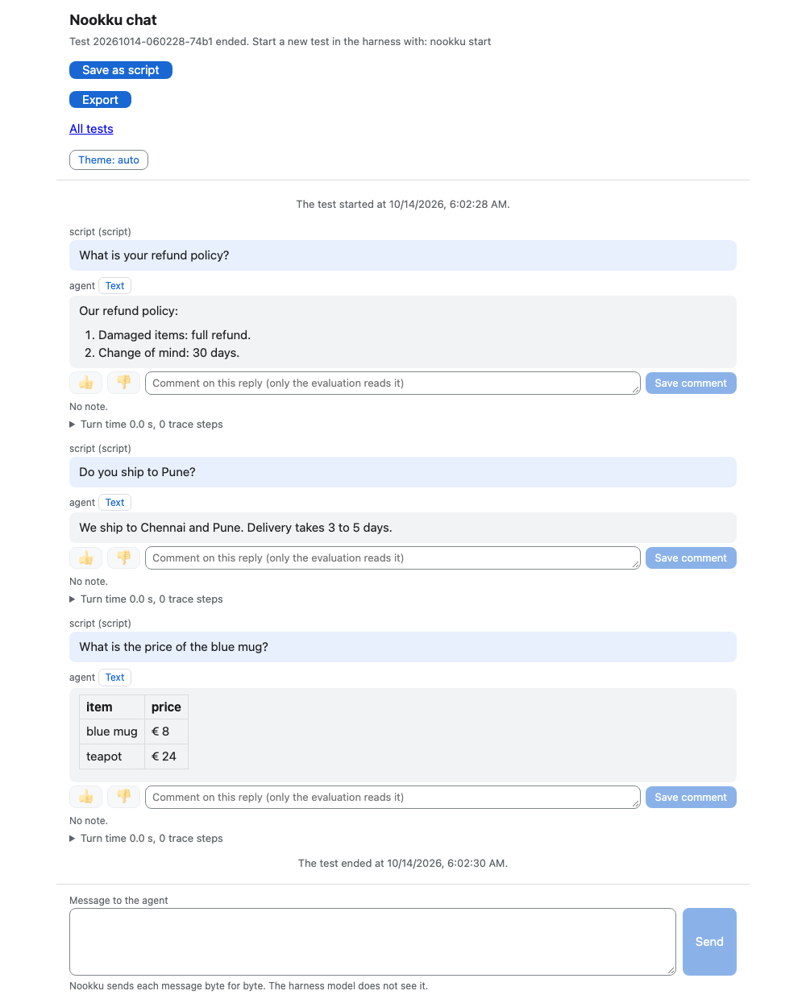

<picture>
  <source media="(prefers-color-scheme: dark)" srcset="https://raw.githubusercontent.com/mohanraj00/nookku/main/docs/assets/logo/nookku-wordmark-dark.svg">
  
</picture>

# Nookku

(நோக்கு - to observe)

**Nookku: an evaluation harness for vertical AI agents**

You build a chat agent, for example a support agent for a shop. You test it from Claude Code or Codex, as your users talk to it. Nookku carries each message and each reply byte for byte, so the [harness model](docs/reference/glossary.md#harness-model) does not retype a message and does not see a reply. Nookku records the test, and an audit proves that the record is exact. Then a model or a person [evaluates](docs/reference/glossary.md#evaluation) the agent against your app spec.

Nookku is for developers of chat agents. It runs on your computer, and it has no hosted service. [docs/faq.md](docs/faq.md#why-not-tell-the-model-to-relay-each-message-exactly) tells why a prompt alone does not keep the messages exact. [CONSTITUTION.md](CONSTITUTION.md#boundaries) says what Nookku does not do.

[](https://github.com/mohanraj00/nookku/actions/workflows/ci.yml)
[](https://pypi.org/project/nookku/)
[](https://pypi.org/project/nookku/)
[](LICENSE)

## Try it with no model

This quickstart needs no harness and no model. It runs from a clean checkout. A script sends 3 messages to the toy shop agent of this repo. Nookku records both sides and audits them.

```bash
uv tool install nookku
git clone https://github.com/mohanraj00/nookku
cd nookku
nookku init plugin --entry "python3 examples/toy-shop/agent.py"
nookku register <<'EOF'
{"model_apis": [], "backends": [], "mcp_servers": [], "databases": [], "other": []}
EOF
nookku check
nookku run --script examples/toy-shop/script.jsonl --no-evaluate
```

`nookku register` gives the egress answer: the toy shop calls no service, so the answer has 5 empty lists ([SPEC.md section 7.11](SPEC.md#711-egress-discovery)). `nookku check` sends one message and shows the reply. `nookku run` sends each message of [the script](examples/toy-shop/script.jsonl) to the agent ([CLI reference](docs/reference/commands/run.md)). It prints the test id and the test folder, then this:

```text
Turns: 3 of 3 messages
Audit: exit 0
Trace: 0 model items in 3 turns, no findings.
PASS
```

To read each message and each reply of the test, run `nookku transcript`. To see the test on the [chat page](docs/reference/commands/chat.md), run `nookku chat` in a separate terminal, and open the URL that it prints. This is the page of that test:



Data: [the record of the test](docs/assets/chat-page/test/) and [the method of the capture](docs/assets/chat-page/capture.json), with nookku 0.4.3 and no harness or model. In 0.4.3, the command `nookku chat` had the name `nookku page`.

## Install

```bash
uv tool install nookku
```

It needs Python 3.10 or later, and it has no runtime dependencies ([pyproject.toml](pyproject.toml)). The docs are for version 0.6.2. To upgrade, end each running test, then run `uv tool upgrade nookku`. [docs/how-to/upgrade.md](docs/how-to/upgrade.md) gives each step, also for verbatim-relay 0.3.x and earlier.

## Next steps

1. **Test the toy shop in Claude Code.** [docs/getting-started.md](docs/getting-started.md) gives each step with its real output. Type the prompt `nookku start`, talk to the agent, then type `nookku end`. The end writes `audit.json` and `report.md` in the [test folder](docs/reference/glossary.md#test-folder) `.nookku/tests/<test-id>/`.
2. **Connect your app.** In the harness, in the project folder of your app, type `!nookku setup`. Then type the prompt "Follow the Nookku setup guide, and connect a test to this app." [docs/how-to/test-your-app.md](docs/how-to/test-your-app.md) gives each step. Your app's code does not change: a thin [entry](docs/reference/glossary.md#entry) in `.nookku/` starts it.
3. **Choose a relay.** The plugin and the project hooks work in Claude Code and in Codex, with the same rules ([docs/how-to/choose-a-relay.md](docs/how-to/choose-a-relay.md)).
4. **Test an agent in a cluster.** Give the tap the Service URL of the agent ([HTTP tap guide](docs/how-to/http-tap.md#an-agent-in-a-cluster)). In a kind cluster, 5 of 5 messages and 5 of 5 replies were exact in each of 3 forms of the tap ([data](proofs/cluster-tap/results.json), [method](docs/results.md#the-http-tap-to-an-agent-at-a-cluster-service-url)).
5. **Gate a release.** Run a declared set of tests and get one verdict ([docs/how-to/gate-a-release.md](docs/how-to/gate-a-release.md)).

## A sample report

At the end of a test, the harness model reads the record and writes `report.md` in the test folder. This is an excerpt of a real report. Nookku 0.6.0 and Claude Code 2.1.319 wrote it, with the project hooks, in a test of [the toy shop with a model](examples/toy-shop-models/README.md). The app has a planted bug: its refund tool compares euros with cents. The model did not see the conversation, and it found the bug in the record and the code.

```markdown
# Test 20261121-060821-5a2a: evaluation

| Class | Turn | Evidence | Issue |
|---|---|---|---|
| business_rule | 2 | trace.jsonl:10, app.py:60, RULES.md:5 | The app paid a €80 refund right away: `shop.refund` input `{"order": "5120", "amount_eur": 80}` → result `{"refund": "RF-966883", "amount_eur": 80, "status": "paid"}`. RULES.md:5 says "A refund above €50 needs the approval of a manager. The refund waits for the approval, and the manager pays it." The cause is a unit mismatch at app.py:60: `if args["amount_eur"] > APPROVAL_LIMIT_CENTS:` compares euros (80) with cents (`APPROVAL_LIMIT_CENTS = 5000`, app.py:28). So in practice the approval check only fires above €5000. state.json:14-19 now holds the paid refund `RF-966883` on order 5120, and there is no `approvals` entry. |
...
```

The full report has 2 rows and 9 notes. Data: [proofs/report/hooks-claude-code.json](proofs/report/hooks-claude-code.json). Method: [docs/results.md](docs/results.md#p5-and-p6-the-evaluation-at-the-end-of-a-test). A report is a model answer, so check its evidence. [Read the results of a test](docs/how-to/read-the-results.md) tells you how.

## How it works

```text
tester ──> harness ──> relay ──────> tap ──stdin/stdout──> entry ──> your app
                         │            │
                         ▼            ▼
                    relay.jsonl    tap.jsonl
            (what you typed      (what the agent
             and saw)             received and sent)
                         │            │
                         └─> audit <──┘   exit 0 clean, 1 break, 2 invalid record
```

- [Harness](docs/reference/glossary.md#harness): Claude Code or Codex, where you type your test messages.
- [Relay](docs/reference/glossary.md#relay): the command `nookku hook`, which the plugin or the project hooks run in the harness. It carries each message and each reply, and the model writes neither.
- [Tap](docs/reference/glossary.md#tap): a proxy in front of your agent. It forwards each byte with no change, and records what the agent received and sent.
- [Entry](docs/reference/glossary.md#entry): a thin wrapper that starts your app and speaks one JSON line in and one JSON line out.
- [Audit](docs/reference/glossary.md#audit): a program that compares the two records byte for byte, and names each break.

[docs/architecture.md](docs/architecture.md#data-flow) shows this flow with each part, and has diagrams of one turn, the test lifecycle and the trace.

Two processes write two records, and the audit compares them byte for byte. It reports 13 break classes ([SPEC.md section 3.3](SPEC.md#33-break-classes)). It fails closed: it never reports clean on a record that it cannot read. 112 audit cases, 21 contract cases, 62 trace cases, 3 gateway cases, 15 seal cases, 16 notes cases, 7 receiver cases, 35 discovery cases and 19 database cases in [conformance/](conformance/) test the spec ([cases](conformance/build.py), [tests](tests/)).

A test also records what your app did. It copies the session files of the app's own Agent SDK or Codex sessions. It records the backend calls, the direct model calls and the OpenTelemetry spans of the app. [docs/architecture.md](docs/architecture.md) shows each part.

## Results

| Proof | Plugin, Claude Code 2.1.319 | Plugin, Codex 0.169.0 | Project hooks, Claude Code 2.1.319 | Project hooks, Codex 0.169.0 |
|---|---|---|---|---|
| Messages reach the agent byte for byte | 10/10 | 10/10 | 10/10 | 10/10 |
| Replies reach the tester byte for byte | 10/10 | 10/10 | 10/10 | 10/10 |
| Same, with a system prompt that tells the model to rewrite both | 5/5 | 5/5 | 5/5 | 5/5 |
| Model call to the agent denied, agent receives nothing | yes | yes | yes | yes |
| Audit finds planted faults | 5/5 | 5/5 | 5/5 | 5/5 |
| After the test, the model has no memory of the conversation, and reads it from the transcript | yes | yes | yes | yes |

Each column ran on nookku 0.6.0 on 2026-11-21. Data: [plugin in Claude Code](proofs/plugin-claude-code/results.json), [plugin in Codex](proofs/plugin-codex/results.json), [project hooks in Claude Code](proofs/hooks-claude-code/results.json), [project hooks in Codex](proofs/hooks-codex/results.json), [evaluation](docs/results.md#p5-the-model-judges-the-record-not-its-memory). Method: [docs/results.md](docs/results.md#1-proofs).

Under pressure, the mechanism had **0 breaks in 1,000 turns**. The test had 40 scripted conversations in each harness, 5 or 20 turns long. They had refusals, HTTP 500 errors, questions back to the tester and ambiguous messages. Each turn was a new harness call. I registered the design before the first run. Method, data and the one deviation: [docs/results.md](docs/results.md#2-benchmark-under-pressure).

## Docs

The how-to rows are in the order of the tasks of a test: choose, connect, run, read the results, evaluate against a spec, fix. The row after them has the tasks that maintain Nookku.

| Kind | Pages |
|---|---|
| Tutorial | [Get started](docs/getting-started.md) |
| How-to: choose | [Choose a relay](docs/how-to/choose-a-relay.md) |
| How-to: connect your app | [Test your own app](docs/how-to/test-your-app.md), [Connect your agent](docs/how-to/connect-your-agent.md), [HTTP tap](docs/how-to/http-tap.md), [Test a streaming agent](docs/how-to/test-a-streaming-agent.md), [Isolate an Agent SDK session](docs/how-to/isolate-agent-sdk.md), [Add a backend](docs/how-to/add-a-backend.md), [Model calls and OpenTelemetry](docs/how-to/record-model-calls.md) |
| How-to: run a test | [Claude Code plugin](docs/how-to/claude-code-plugin.md), [Claude Code project hooks](docs/how-to/claude-code-project-hooks.md), [Codex](docs/how-to/codex.md) |
| How-to: gate a release | [Gate a CI job on a verdict](docs/how-to/gate-a-ci-job.md), [Gate a release with a set of tests](docs/how-to/gate-a-release.md), [Gate a rollout on a gate result](docs/how-to/gate-a-rollout.md) |
| How-to: read the results | [Read the results of a test](docs/how-to/read-the-results.md), [Import a finding record into another test suite](docs/how-to/import-a-finding-record.md) |
| How-to: measure a verifier | [Measure a verifier on seeded false claims](docs/how-to/measure-a-verifier.md) |
| How-to: evaluate against a spec | [Evaluate your app against its spec](docs/how-to/evaluate-against-your-spec.md) |
| How-to: fix | [Troubleshooting](docs/troubleshooting.md), [Recover a stuck test](docs/how-to/recover-a-stuck-test.md) |
| How-to: maintain | [Upgrade](docs/how-to/upgrade.md), [Remove](docs/how-to/remove.md) |
| Reference | [CLI](docs/reference/cli.md), [Configuration](docs/reference/config.md), [Records](docs/reference/records.md), [Glossary](docs/reference/glossary.md), [SPEC.md](SPEC.md), [Results](docs/results.md) |
| Explanation | [Architecture](docs/architecture.md), [Limits](docs/limits.md), [FAQ](docs/faq.md), [Worked evaluations](docs/evaluation-example.md) |

The full map is [docs/index.md](docs/index.md). Read [docs/limits.md](docs/limits.md) before you trust a result: the deny is best effort, and the entry is not audited.

## Contribute

Read [CONTRIBUTING.md](CONTRIBUTING.md) and the [code of conduct](CODE_OF_CONDUCT.md). The pages for contributors are in [docs/contributing/](docs/contributing/), for example [Run the proofs](docs/contributing/run-the-proofs.md) and [Code quality](docs/contributing/code-quality.md). Report a security problem as [SECURITY.md](SECURITY.md) says.

## License

Apache-2.0. See [LICENSE](LICENSE).
